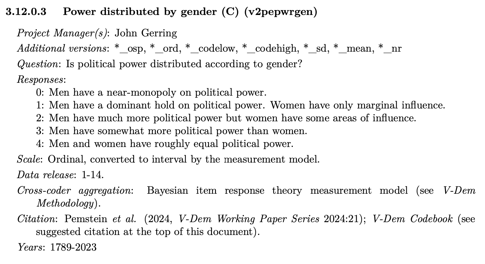

# Factor Variables, T-tests, and Regression

Week 6 tutorial goals:

  * Factors -- `factor()`
  * Difference in means -- `t.test()`
  * Linear regression -- `lm()`
  * Visualizing regression models using `ggplot`


## Before the start of class
```{r, echo=F}
library(tidyverse)
library(parameters)
```

### Download files from Quercus {-}

Move all the files into your R project `.Rproj` folder

Open your R project

### Install new package and load all packages required for this class {-}
```{r,eval=F}
install.packages("parameters")
library(parameters)
library(tidyverse)
```

### Load data {-}
```{r,echo=F}
ces <- read.csv("data/ces2025_small.csv")
```

```{r,eval=F}
ces <- read.csv("ces2025_small.csv")
```

## Recap


### Determining plot based on type of variable {-}

* Single categorical (nominal/ordinal) variable -- Bar chart `geom_bar()`
* Single numerical (interval/ratio) variable -- Histogram `geom_histogram()`
* Categorical (nominal/ordinal) and categorical -- Stacked bar chart `geom_bar()`
* Categorical (nominal/ordinal) and numerical (interval/ratio) -- Box and whiskers `geom_boxplot()`
* Numerical (interval/ratio) and numerical -- Scatter plot `geom_point()`


### Bar chart for a nominal variable {-}

* born_canada
```{r}
unique(ces$born_canada)
```

```{r}
ggplot(ces, aes(x=born_canada)) +
  geom_bar()
```

The third bar is `NA`: 132 people did not answer the question.

  + How could we not show the NAs?

Use `filter()` to keep only the people who answered, then pipe the result into `ggplot()`. `is.na()` is `TRUE` when a value is missing, so `is.na(ces$born_canada) == FALSE` keeps the rows that are **not** missing.

  + Adding `na.rm=TRUE` to `geom_bar()` does **not** remove the `NA` bar. The NAs have to be removed from the data first.

```{r}
ces |>
  filter(is.na(ces$born_canada) == FALSE) |> # keep people who are not NA for born_canada
  ggplot(aes(x=born_canada)) +
  geom_bar()
```

This is the same `is.na()` we used with `table()` last week to count missing values:
```{r}
table(is.na(ces$born_canada))
```


Now lets try another variable, Union:

```{r}
ggplot(ces, aes(x=union)) +
  geom_bar()
```

Wait! Something is wrong!


## Factors

A **factor** is R's data type for categories. Similar to character, but has levels with an order. Order can be arbitrary (province), or meaningful (agree/disagree). 

  + R assumes all letters/words are character and all numbers are numeric

  + Use `factor()` to turn a variable into a factor. 
  
  + Why? When numbers or characters are really categories. 


### Numbers that are really categories {-}

The variable `union` asks "Do you belong to a union?". It is coded 1 = yes and 0 = no. The numbers are just labels for two categories, so `union` is a nominal variable, or maybe ordinal. But R stores it as a number.
```{r}
class(ces$union)
```

Because `union` is a number, `ggplot()` treats it as continuous. This boxplot is wrong: it draws one box instead of one box for each group.
```{r}
ggplot(ces, aes(x=union, y=ndp_rating)) +
  geom_boxplot()
```

Notice the x axis: 0.25, 0.50, 0.75. R thinks `union` could be any number between 0 and 1. The warning message about a "continuous x aesthetic" is also a sign that something is wrong.

Wrapping the variable in `factor()` tells R that it is a category, but only temporarily.
```{r}
class(factor(ces$union))
```

We use `mutate()` to save the factor as a new column, `union_factor`. The original `union` column stays the same. Now we can use `union_factor` in every plot without wrapping it in `factor()` each time.
```{r}
ces <- ces |>
  mutate(union_factor = factor(union))

class(ces$union_factor)
```

```{r}
ggplot(ces, aes(x=union_factor, y=ndp_rating)) +
  geom_boxplot()
```

Now there is one box for non-members (0), one for union members (1), and one for people who did not answer (`NA`).

### Setting the order of categories {-}

Look at another variable: born_canada 

Text categories are sorted alphabetically, so "Born elsewhere" comes before "Born in Canada".
```{r}
ggplot(ces, aes(x=born_canada, y=con_rating)) +
  geom_boxplot()
```

The `levels` argument of `factor()` sets the order ourselves. Write the categories exactly as they appear in the data. Like with `union`, we use `mutate()` to save it as a new column, `born_canada_order`.
```{r}
ces <- ces |>
  mutate(born_canada_order = factor(born_canada, levels=c("Born in Canada","Born elsewhere")))
```

```{r}
ggplot(ces, aes(x=born_canada_order, y=con_rating)) +
  geom_boxplot()
```


This only changes the order of the categories. The original `born_canada` column stays the same.


***Now write some code to change the union categories to words instead of 0 and 1, then make a boxplot ***


## Canadian Election Study data

We use the same 2025 Canadian Election Study (CES) data as last week.\
Stephenson, Laura B., Allison Harell, and Daniel Rubenson. 2025 Canadian Election Study (CES). [dataset]

These are the variables we use today:

| variable      | desc.                                                                             |
|---------------|-----------------------------------------------------------------------------------|
| born_canada   | Where the respondent was born: "Born in Canada" or "Born elsewhere"               |
| union         | Do you belong to a union? (1 = yes, 0 = no)                                       |
| con_rating    | How do you feel about the Conservative Party? (0 = really dislike, 100 = really like) |
| ndp_rating    | How do you feel about the NDP? (0 = really dislike, 100 = really like)            |

Today we compare two groups: people born in Canada and people born elsewhere. Do they feel differently about the parties?

This is a **comparison, not an experiment**. In an experiment, the researcher randomly decides who gets the treatment, so the groups are alike in every other way. Nobody randomly decided where our respondents were born. People born in Canada and people born elsewhere also differ in other ways (for example age, province or religion). So a difference between the groups does not show that where you were born *causes* the difference.

Display first five rows of the dataset.
```{r}
head(ces,5)
```

## Difference in means -- `t.test()`

### Syntax {-}

The dependent variable and independent variable are separated by a `~`. 

  + this is a common format, same for regression

The dependent variable should be an interval variable (like a 0-100 rating)

The group variable must have exactly two groups. `

  + t.test()` leaves out `NA`s automatically.


### Outcome 1: Conservative Party rating {-}
```{r}
t.test(con_rating ~ born_canada, data = ces)
```

This output shows the mean of each group and a confidence interval, but it does not show the difference itself. The p-value is also hard to read (`< 2.2e-16` is a very small number).

### Making the output easier to read -- `model_parameters()` {-}

The function `model_parameters()` from the package `parameters` turns the t-test output into a clear table. We pipe the t-test into it.

  + the table is actually a tiny one row dataframe, with each number as a column
```{r}
t.test(con_rating ~ born_canada, data = ces) |>
  model_parameters()
```

The table shows the mean of each group, the `Difference`, its 95% confidence interval (`95% CI`) and the p-value (`p`).

Be careful of the direction of the difference. `t.test()` takes the mean of the first group minus the mean of the second group. The groups are in numerical order, or alphabetical order if they are text. So here it is "Born elsewhere" minus "Born in Canada": 51.11 - 42.02 = 9.09.

### Interpreting the difference {-}

Respondents born elsewhere rate the Conservative Party 9 points higher (on a 0-100 scale) than respondents born in Canada. 

The difference is statistically significant (p < .001), so the correlation very likely isn't due to chance.

This is not an experiment, so we can't say that being born outside Canada *causes* people to like the Conservatives more.

  + An alternative explaination would be...

### Outcome 2: NDP rating {-}
```{r}
t.test(ndp_rating ~ born_canada, data = ces) |>
  model_parameters()
```

Respondents born elsewhere rate the NDP 0.46 points lower than respondents born in Canada. The difference is not statistically significant (p = 0.401), and the confidence interval includes 0.


## Visualizing differences in means

### Estimates and confidence intervals -- geom_pointrange() {-}

The output of `model_parameters()` is a data frame, so we can pipe it straight into `ggplot()`. 

Because the estimate is one-dimensional (you only need either x or y), the other dimension can be used as a name label instead of a variable. In this code, y=Difference is the estimate. x="Conservative rating" is just an axis label, so it is in quotes.
```{r}
t.test(con_rating ~ born_canada, data = ces) |>
  model_parameters() |>
  ggplot(aes(y=Difference,x="Conservative rating")) + 
  geom_pointrange(aes(ymax=CI_high,ymin=CI_low))
```

`geom_pointrange()` **syntax** (**do not run the following code**)
```{r, eval=F}
ggplot(<name of dataframe>,
       aes(y = Difference, # from the model_parameters() output
           x = "name of x-axis label")) + # x will be the x-axis label
  geom_pointrange(aes(ymax=CI_high,ymin=CI_low)) # from the model_parameters() output
```


#### To highlight whether the difference is statistically significant, we usually add the 0-intercept line {-}
```{r}
t.test(con_rating ~ born_canada, data = ces) |>
  model_parameters() |>
  ggplot(aes(y=Difference,x="Conservative rating")) +
  geom_pointrange(aes(ymax=CI_high,ymin=CI_low)) +
  geom_hline(aes(yintercept=0),linetype="dashed") # this adds a horizontal line
```

#### To beautify the graph, we might change its `theme` and change x and y labels (`xlab` and `ylab`). {-}
Put the direction of the difference in the label, so readers know which group is higher.
```{r}
t.test(con_rating ~ born_canada, data = ces) |>
  model_parameters() |>
  ggplot(aes(y=Difference,x="Conservative rating")) +
  geom_pointrange(aes(ymax=CI_high,ymin=CI_low)) +
  geom_hline(aes(yintercept=0),linetype="dashed") +
  theme_bw() + # black and white theme
  xlab("") + # hides the x label
  ylab("Difference in means (Born elsewhere - Born in Canada)") # replaces the y label
```

The same plot for the NDP rating. Here the confidence interval crosses the dashed 0 line, so the difference is not statistically significant.
```{r}
t.test(ndp_rating ~ born_canada, data = ces) |>
  model_parameters() |>
  ggplot(aes(y=Difference,x="NDP rating")) +
  geom_pointrange(aes(ymax=CI_high,ymin=CI_low)) +
  geom_hline(aes(yintercept=0),linetype="dashed") +
  theme_bw() +
  xlab("") +
  ylab("Difference in means (Born elsewhere - Born in Canada)")
```

You could also flip the x and y.
```{r}
t.test(ndp_rating ~ born_canada, data = ces) |>
  model_parameters() |>
  ggplot(aes(x=Difference,y="NDP rating")) +
  geom_pointrange(aes(xmax=CI_high,xmin=CI_low)) +
  geom_vline(aes(xintercept=0),linetype="dashed") +
  theme_bw() +
  ylab("") +
  xlab("Difference in means (Born elsewhere - Born in Canada)")
```


## Linear regression

### Load a different dataset (some variables from Varieties of Democracies data set) {-}
```{r,echo=F}
vdem <- read.csv("data/vdem_w6tutorial.csv")
```

```{r,eval=F}
vdem <- read.csv("vdem_w6tutorial.csv")
```


Each row is a country in 2023 (179 countries).

* Variables from Varieties of Democracy dataset

  + Power distributed by gender (C) (v2pepwrgen): Q. Is political power distributed according to gender? (0: Men have a near-monopoly on political power, 4: Men and women have roughly equal political power.)
  + Female journalists (C) (v2mefemjrn): Q. Please estimate the percentage (%) of journalists in the print and broadcast media who are women. (Interval)

### V-Dem codebook {-}
```{r echo=FALSE, out.width = "70%", fig.align = "center"}

```

More details on codebook next week!

### From ordinal to interval {-}

The (C) means the variable is coded by country experts. Each expert answers the question on the 0 to 4 scale above. That answer is **ordinal**: the categories have an order, but the gaps between them are not equal.

V-Dem then combines the answers of all the experts for a country into one score. This score is not limited to 0, 1, 2, 3 or 4. It can be any number, including decimals and negative numbers. Higher numbers still mean more equal power between men and women. Because it is a continuous number, we can treat it as an **interval** variable.
```{r}
summary(vdem$v2pepwrgen)
```

Notice the minimum is below 0 and the maximum is above 3. These are not the 0 to 4 answers from the codebook.

### Bivariate relationship using a scatter plot `geom_point()` {-}

Do countries with more women journalists also have more equal political power between men and women?
```{r}
vdem |>
  ggplot(aes(y=v2pepwrgen,x=v2mefemjrn)) +
  geom_point() +
  theme_classic()
```

### What does a regression do? {-}

A linear regression finds the straight line that best fits the points.
```{r,echo=F}
journalists_model <- lm(v2pepwrgen ~ v2mefemjrn, data = vdem)

vdem$fitted <- journalists_model$fitted.values

vdem |>
  ggplot(aes(x=v2mefemjrn,y=v2pepwrgen)) +
  geom_point() +
  geom_line(aes(y=fitted)) +
  theme_classic()
```

<!--
For each country, the line gives a **predicted value** (red circles): the value we would guess for that country based only on its share of women journalists.
```{r,echo=F,eval=F}
vdem |>
  ggplot(aes(x=v2mefemjrn,y=v2pepwrgen)) +
  geom_point(alpha=0.5) +
  geom_point(aes(y=fitted),shape=1,color="maroon") +
  theme_classic()
```
-->


The gap between a country's real value and its predicted value is the **error** (the grey lines). Some countries are above the line and some are below.
```{r,echo=F}
vdem |>
  ggplot(aes(x=v2mefemjrn,y=v2pepwrgen)) +
  geom_point(alpha=0.5) +
  geom_point(aes(y=fitted),shape=1,color="maroon") +
  geom_segment(aes(yend=fitted,xend=v2mefemjrn),alpha=0.5) +
  theme_classic()
```

The regression line is the line that makes these errors as small as possible overall.
```{r,echo=F}
vdem |>
  ggplot(aes(x=v2mefemjrn,y=v2pepwrgen)) +
  geom_point(alpha=0.5) +
  geom_line(aes(y=fitted),color="maroon") +
  geom_segment(aes(yend=fitted,xend=v2mefemjrn),alpha=0.5) +
  theme_classic()
```

### Running a regression -- `lm()` {-}

`lm()` stands for "linear model". It uses the same `~` format as `t.test()`: the dependent variable goes on the left and the independent variable on the right. Like `t.test()`, it leaves out `NA`s automatically.

`lm()` **syntax** (**do not run the following code**)
```{r, eval=F}
lm(dependent variable ~ independent variable, data = <name of dataframe>)
```

We save the regression as an object and use `model_parameters()` to make the output easy to read, just like with the t-test.
```{r}
journalists_model <- lm(v2pepwrgen ~ v2mefemjrn, data = vdem)

journalists_model |>
  model_parameters()
```

The table has two rows:

* `v2mefemjrn`: the **coefficient**, or slope, of the line. This is the number we care about.

* `(Intercept)`: the predicted value of the dependent variable when the independent variable is 0. Not useful.

### Interpreting the coefficient {-}

The coefficient is interpreted as...


The relationship is statistically significant (p < .001), and the confidence interval (0.04 to 0.07) does not include 0.


This is not an experiment, so it does not show that women journalists *cause* more equal power. Other things, like wealth or democracy, could explain both.

### Visualizing regression line using `geom_smooth()` {-}

`geom_smooth(method="lm")` runs the same regression and draws the line. The grey band around the line is the 95% confidence interval.
```{r}
vdem |>
  ggplot(aes(y=v2pepwrgen,x=v2mefemjrn)) +
  geom_point(alpha=0.5) + # alpha changes the transparency of the points
  geom_smooth(method="lm") + # lm = linear model
  theme_classic()
```


## Credits
* This lesson uses data from
  * Stephenson, Laura B., Allison Harell, and Daniel Rubenson. 2025 Canadian Election Study (CES).
  * Varieties of Democracy (V-Dem) Project. [V-Dem Dataset](https://www.v-dem.net/data/the-v-dem-dataset/).

