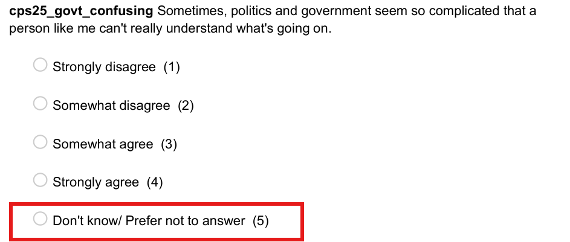
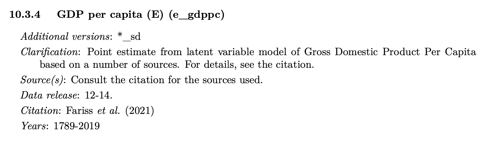
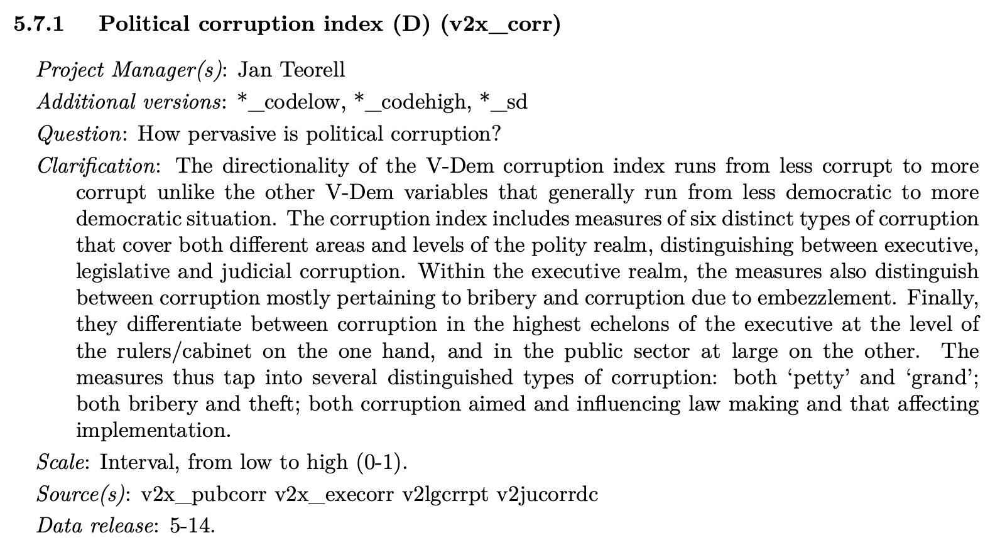
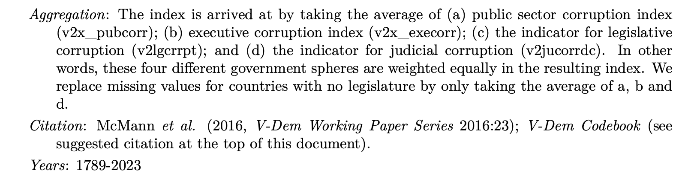

# Introducing project datasets

Week 7 tutorial goals:

  * Learning to use the project datasets
  
    + Canadian Election Study 2025
    + Varieties of Democracy (VDem)
    + World Values Survey (Wave 7)
    + Asian Barometer (Wave 5)

## Set-up

### Download project datasets AND Codebooks {-}

In Projects folder on Quercus

  + Canadian Election Study 2025
  + World Values Survey
  + Asia Barometer
  + Varieties of Democracy
  
  This will take a while because the files are large.

### Download the other file (`W7.R`) and put everything in your R project folder {-}


### Load libraries {-}
```{r,echo=F}
library(tidyverse)
library(haven)
library(sjPlot)
```

#### Install package "haven" {-}
```{r,eval=F}
library(tidyverse)
library(sjPlot)

install.packages("haven")
library(haven) # to read Stata .dta files
```

## Overview: Use of data sets

This is the general approach we will take to use the datasets for the project assignment.

### Step 1: Select one of the four data sets {-}

Each data set focuses on a different type of data. Later you will be selecting variables from *one dataset* for your term project. Take a look at the code book and decide which data set you want to use.

### Step 2: Select your variables {-}

Look at the **codebook** to find your variables.

### Step 3: Trim down the data set {-}

Before examining the variables, make a mini-version of the dataset with only the variables you selected.

#### Additional step: {-}
* For the following data sets, you have to select a subset of the data
  + VDem: Select one year between 2000 and 2023 (GDP per capita only goes to 2019)
  + World Values Survey: Select one country
  + Asian Barometer: Select one country

### Step 4: Examine the univariate distribution and bivariate relationship {-}

## Canadian Election Study 2025
Look at the codebook, which can be found in the same folder as the dataset.

### Step 2: Select your variables {-}

Select the variables you want and assign them to the object `my_vars`.
```{r}
my_vars <- c("cps25_news_cons","cps25_govt_confusing") #news consumption and internal political efficacy
```

### Step 3: Trim down your data set {-}

The CES is one survey of Canadians in one year, so we don't need to select a year or a country.
```{r}
ces_select <- read_dta("Project/CES2025/2025 Canadian Election Study v1.dta") |> # read_dta() reads Stata (.dta) files
  select(all_of(my_vars)) # keep only the variables named in my_vars
```

### Step 4: Examine the univariate distribution and bivariate relationship {-}

#### Look at the summary statistics {-}

Note that the ordinal variables are measured as numerical variables.
```{r}
summary(ces_select) # the maximum values (7 and 5) are "Don't know" codes, not real answers
```


#### Examine the variables {-}

Bar chart for ordinal variables. Remember to change the numerical variable into a factor with `factor()`.
```{r}
ggplot(ces_select,aes(x=factor(cps25_news_cons))) + # factor() gives each answer its own bar
  geom_bar()
```

```{r}
ggplot(ces_select,aes(x=factor(cps25_govt_confusing))) +
  geom_bar()
```


#### Replace nominal categories not found on the ordinal scale to `NA` {-}

```{r echo=FALSE, out.width = "70%", fig.align = "center"}

```

What should we do with don't know or refused?

Use the `if_else()` function to make a new variable and set to `NA`.
```{r}
ces_select <- ces_select |> # save the new variables in the same data frame
  mutate(govt_confusing=if_else(cps25_govt_confusing==5, # don't know or refused
                                NA, #if yes
                                cps25_govt_confusing), #if no
         news_cons=if_else(cps25_news_cons==7, # don't know or refused
                           NA, #if yes
                           cps25_news_cons)) #if no
```


#### Bivariate relationship {-}

If both variables are nominal/ordinal, we can use a stacked bar chart.

is.na() is TRUE when a value is missing, so "== FALSE" keeps people who answered.

Use is.na() on both variables, so excluded if missing on either one 

```{r}
ces_select |>
  filter(is.na(news_cons) == FALSE, is.na(govt_confusing) == FALSE) |> # comma means both conditions must be true
  ggplot(aes(x=factor(news_cons),fill=factor(govt_confusing))) +
  geom_bar(position="fill") + # "fill" makes every bar the same height, so it shows proportions
  theme_bw()
```


### Remove all from environment {-}
To avoid mixing up objects, clear environment before moving on to the next dataset.
```{r}
rm(list=ls())
```


## VDem
Look at the codebook, which can be found in the same folder as the dataset.

### Step 2: Select your variables {-}

Select the variables you want and assign them to the object `my_vars`. I've selected:

* Country name
* Country ID
* Year
* **Political corruption index (v2x_corr)**
* **GDP per capita (e_gdppc)**

```{r}
my_vars <- c("country_name", "country_id", "year", 
          "v2x_corr","e_gdppc")
```

```{r echo=FALSE, out.width = "100%", fig.align = "center"}

```

```{r echo=FALSE, out.width = "100%", fig.align = "center"}

```

```{r echo=FALSE, out.width = "100%", fig.align = "center"}

```

### Step 3: Trim down the data set (select a year) {-}

Select a year for analysis and use the `filter` function to extract the data for that year. 

Note that the VDem file in your project folder is a reduced version of the original [dataset](https://www.v-dem.net/data/the-v-dem-dataset/). 
```{r}
vdem_selected <- read.csv("Project/VDem/vdem2000_2023.csv") |>
  select(all_of(my_vars)) |>
  filter(year==2019)
```

### Step 4: Examine the univariate distribution and bivariate relationship {-}

#### Look at the summary statistics {-}
```{r}
summary(vdem_selected)
```


#### Univariate: Examine each variable {-}

Plot histograms because both of the variables are interval/numerical measures. 

If you choose a variable with few categories, use a bar chart.
```{r}
ggplot(vdem_selected,aes(x=v2x_corr)) +
  geom_histogram()
```

#### GDP per capita is measured in thousands of dollars {-}

```{r}
ggplot(vdem_selected,aes(x=e_gdppc)) +
  geom_histogram()
```

#### Bivariate relationship {-}

A scatter plot is selected here because both variables are interval/numerical measures.
```{r}
ggplot(data=vdem_selected,aes(x=v2x_corr,y=e_gdppc)) +
  geom_point()
```

#### Change the theme and transparency of points {-}

This is useful if the dataset is big and the points overlap.
```{r}
ggplot(data=vdem_selected,aes(x=v2x_corr,y=e_gdppc)) +
  geom_point(alpha=.5) +
  theme_bw()
```

### Remove all from environment {-}
Clear environment before moving on to the next dataset.
```{r}
rm(list=ls())
```


## World Values Survey (Wave 7, 2017-2022)

### Step 2: Select your variables {-}

Look at the codebook and choose your variables.
```{r}
my_vars <- c("B_COUNTRY_ALPHA","Q73","Q236") #confidence in parliament, experts versus government
```

### Step 3: Trim down your data set {-}

#### For the WVS data set, select one country {-}

WVS dataset includes a collection of individual surveys in multiple countries. As such, it creates a nested data structure, where we would expect individual-level factors to be confounded by country-level differences. For simplicity, we explore variations within countries.
```{r}
wvs_canada <- read_rds("Project/WVS/WVS_Cross-National_Wave_7_rds_v6_0.rds") |>
  select(all_of(my_vars)) |>
  filter(B_COUNTRY_ALPHA=="CAN") # choice of country: Canada
```

### Step 4: Examine the univariate distribution and bivariate relationship {-}

The response categories contain a mix of ordinal and nominal categories.
```{r}
summary(wvs_canada)
```

#### Replace nominal categories not found on the ordinal scale to `NA` {-}

```{r echo=FALSE, out.width = "70%", fig.align = "center"}

```

```{r echo=FALSE, out.width = "70%", fig.align = "center"}

```

Make all the negative codes (don't know, no answer, etc.) `NA`.

  + Create new variables, don't change the originals! 
```{r}
wvs_canada <- wvs_canada |>
  mutate(confidence_parliament=if_else(Q73<0,
                                       NA,
                                       Q73),
         experts_decide=if_else(Q236<0,
                                NA,
                                Q236))
```


#### Examine the variables {-}
Examine the variables to make sure they are as you expect them to be after the transformation.
```{r}
summary(wvs_canada)
```

```{r}
wvs_canada |>
  filter(is.na(confidence_parliament) == FALSE) |>
  ggplot(aes(x=factor(confidence_parliament))) +
  geom_bar()
```

```{r}
wvs_canada |>
  filter(is.na(experts_decide) == FALSE) |>
  ggplot(aes(x=factor(experts_decide))) +
  geom_bar()
```


```{r}
tab_xtab(var.col=wvs_canada$confidence_parliament, var.row=wvs_canada$experts_decide,
         show.col.prc = TRUE)
```

```{r}
wvs_canada |>
  filter(is.na(confidence_parliament) == FALSE, is.na(experts_decide) == FALSE) |>
  ggplot(aes(x=factor(confidence_parliament),fill=factor(experts_decide))) +
  geom_bar(position="fill") +
  theme_bw()
```

```{r}
wvs_canada |>
  filter(is.na(confidence_parliament) == FALSE, is.na(experts_decide) == FALSE) |>
  ggplot(aes(x=factor(confidence_parliament),fill=factor(experts_decide))) +
  geom_bar(position="fill") +
  theme_bw() +
  xlab("Lack of Confidence in Parliament") +
  ylab("Proportion") +
  scale_fill_manual(name="Expert versus Govt", #legend label
                    values = c("navyblue","blue","skyblue","grey"), #color specification
                    labels = c("Very Good","Fairly Good", "Fairly Bad", "Very Bad"))
```


### Other countries {-}

#### United States {-}
```{r}
read_rds("Project/WVS/WVS_Cross-National_Wave_7_rds_v6_0.rds") |>
  select(all_of(my_vars)) |>
  filter(B_COUNTRY_ALPHA=="USA") |>
  mutate(confidence_parliament=if_else(Q73<0,
                                       NA,
                                       Q73),
         experts_decide=if_else(Q236<0,
                                NA,
                                Q236)) |>
  filter(is.na(confidence_parliament) == FALSE, is.na(experts_decide) == FALSE) |>
  ggplot(aes(x=factor(confidence_parliament),fill=factor(experts_decide))) +
  geom_bar(position="fill") +
  theme_bw() +
  xlab("Lack of Confidence in Congress") +
  ylab("Proportion") +
  scale_fill_manual(name="Expert versus Govt", #legend label
                    values = c("navyblue","blue","skyblue","grey"), #color specification
                    labels = c("Very Good","Fairly Good", "Fairly Bad", "Very Bad"))
```


#### Japan {-}
```{r}
read_rds("Project/WVS/WVS_Cross-National_Wave_7_rds_v6_0.rds") |>
  select(all_of(my_vars)) |>
  filter(B_COUNTRY_ALPHA=="JPN") |>
  mutate(confidence_parliament=if_else(Q73<0,
                                       NA,
                                       Q73),
         experts_decide=if_else(Q236<0,
                                NA,
                                Q236)) |>
  filter(is.na(confidence_parliament) == FALSE, is.na(experts_decide) == FALSE) |>
  ggplot(aes(x=factor(confidence_parliament),fill=factor(experts_decide))) +
  geom_bar(position="fill") +
  theme_bw() +
  xlab("Lack of Confidence in Parliament") +
  ylab("Proportion") +
  scale_fill_manual(name="Expert versus Govt", #legend label
                    values = c("navyblue","blue","skyblue","grey"), #color specification
                    labels = c("Very Good","Fairly Good", "Fairly Bad", "Very Bad"))
```


### Remove all from environment {-}
To avoid any misspecification of variables, clear environment before moving on to the next dataset.
```{r}
rm(list=ls())
```


## Asian Barometer (Wave 5, 2018-2021)

```{r,include=F,eval=F}
183 How much influence does the United States have on our country?

Independent variable 2: Views toward China
177 Does China do more good or harm to Asia?
181 How much influence does China have on our country?
182 General speaking, the influence China has on our country is?
  
DV: Views toward democracy
171 The citizens in our country are not prepared for a democratic system
172 Democracy negatively affects social and ethical values in our country
```

### Step 2: Select your variables {-}

Look at the codebook and choose your variables. I have chosen the following
```{r,eval=F}
Independent variable: Views toward the US
175 Does the United States do more good or harm to Asia?
184 General speaking, the influence the United States has on our country is?

DV: Views toward democracy (1 strongly agree - 4 strongly disagree)
169 Democratic regimes are indecisive and full of problems
```

```{r}
my_vars <- c("country",
           "q175","q184",
           "q169")
```

### Step 3: Trim down your data set {-}

#### For the Asian Barometer data set, select one country {-}

```{r}
ab_korea <- read_dta("Project/asianbarometer_wave5/20230504_W5_merge_15.dta") |>
  select(all_of(my_vars)) |>
  filter(country==3) # South Korea (refer to codebook)

summary(ab_korea)
```


#### Replace nominal categories not found on the ordinal scale to `NA` {-}

Check the codebook for each variable. `q169` and `q175` go from 1 to 4, but `q184` goes from 1 to 6. Two kinds of codes become `NA` in the new variables:

* -1 = missing (for example, the question was not asked in that country)
* the codes after the scale: 7 = do not understand the question, 8 = can't choose, 9 = decline to answer

`|` means "or", so `q169 < 1 | q169 > 4` is `TRUE` for -1 and for 7, 8 and 9.
```{r}
ab_korea <- ab_korea |>
  mutate(democracy_problems = if_else(q169 < 1 | q169 > 4, NA, q169),
         us_good_harm = if_else(q175 < 1 | q175 > 4, NA, q175),
         us_influence = if_else(q184 < 1 | q184 > 6, NA, q184))
```

### Step 4: Examine the univariate distribution and bivariate relationship {-}

```{r}
ab_korea |>
  filter(is.na(democracy_problems) == FALSE) |>
  ggplot(aes(x=factor(democracy_problems))) +
  geom_bar()
```

```{r}
ab_korea |>
  filter(is.na(us_good_harm) == FALSE) |>
  ggplot(aes(x=factor(us_good_harm))) +
  geom_bar()
```


#### Examining the relationship of perceptions of US and views of democracy {-}

#### Independent variable 1: q175 {-}
```{r}
ab_korea |>
  filter(is.na(democracy_problems) == FALSE, is.na(us_good_harm) == FALSE) |>
  ggplot(aes(fill=factor(democracy_problems),x=factor(us_good_harm))) +
  geom_bar(position="fill") +
  theme_bw()
```

#### Independent variable 2: q184 {-}
```{r}
ab_korea |>
  filter(is.na(democracy_problems) == FALSE, is.na(us_influence) == FALSE) |>
  ggplot(aes(fill=factor(democracy_problems),x=factor(us_influence))) +
  geom_bar(position="fill") +
  theme_bw()
```

### Remove all from environment {-}
```{r}
rm(list=ls())
```


