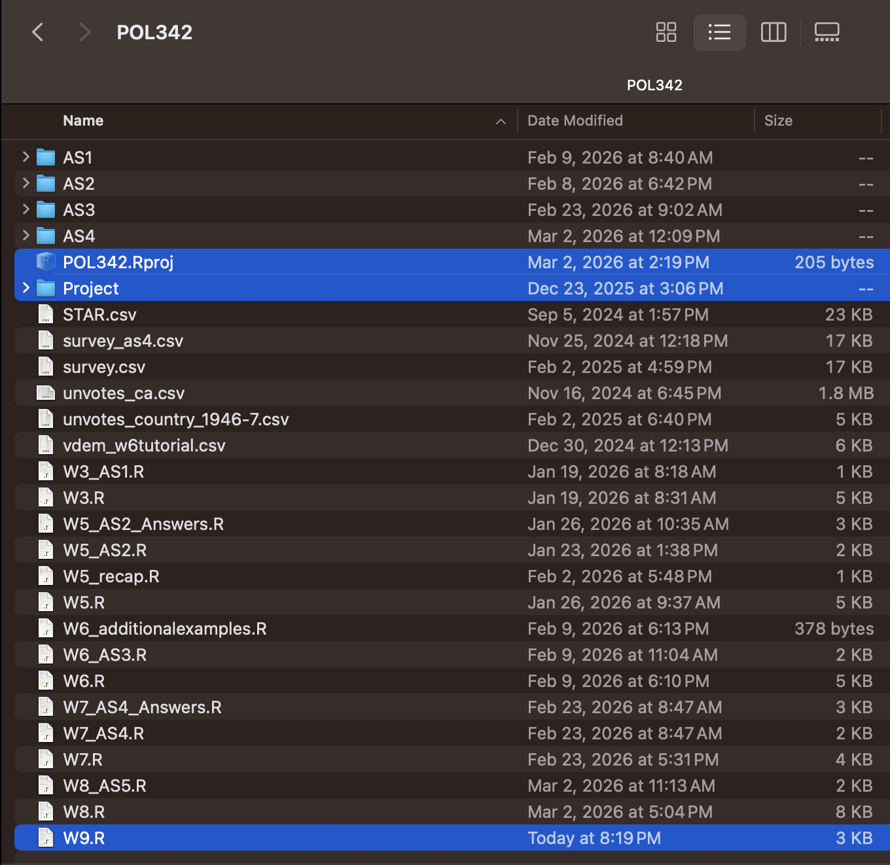
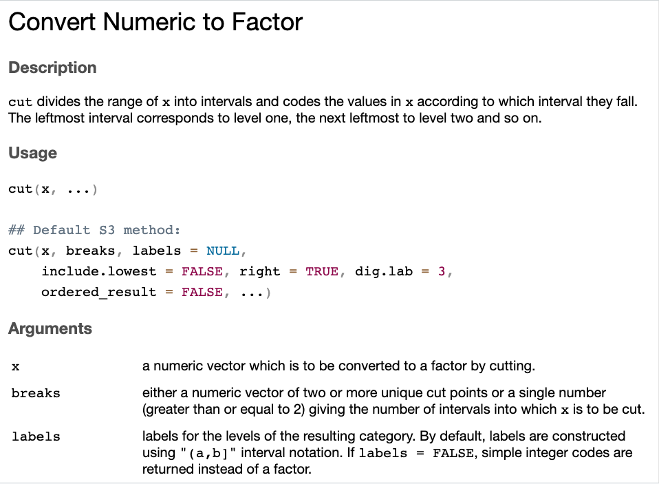
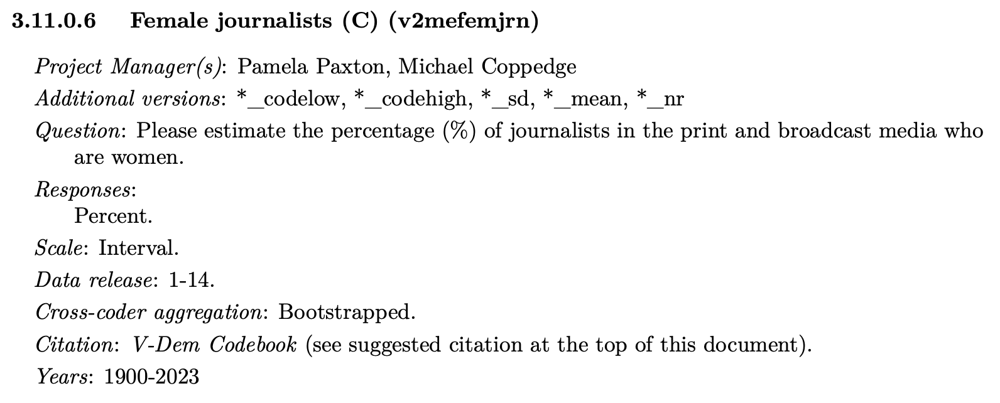

# Crosstabs using continuous variables

Week 8 tutorial goals:
  * Transforming continuous variables into ordinal variables
  * Creating cross-tabs
  * Saving cross-tabs
  * Reversing the scale of a variable

## Set-up

### Make sure you have your project datasets and `W8.R` {-}
```{r echo=FALSE, out.width = "100%", fig.align = "center"}

```


### Load libraries {-}
```{r}
library(tidyverse)
# install.packages("haven") # if you haven't installed the package
library(haven)
library(sjPlot)
```

## VDem

### Load Data {-}
```{r}
vars <- c("country_name", "country_id", "year", 
          "v2x_libdem","e_gdppc","v2mefemjrn", "v2pepwrgen")

vdem_selected <- read.csv("Project/VDem/VDem_post2000.csv") |>
  select(all_of(vars)) |>
  filter(year==2010) 
```

* Variables selected:
  * `v2x_libdem`: Liberal democracy index
  * `e_gdppc`: GDP per capita
  * `v2mefemjrn`: % of female journalist
  * `v2pepwrgen`: Power distributed by gender

### Create ordinal categories using function `cut()` {-}
```{r}
?cut # pull up the documentation for `cut()`
```

```{r echo=FALSE, out.width = "100%", fig.align = "center"}

```

#### Consider this variable: v2mefemjrn (% of female journalists) {-}
```{r echo=FALSE, out.width = "100%", fig.align = "center"}

```

```{r}
head(vdem_selected$v2mefemjrn)
```


```{r}
cut(vdem_selected$v2mefemjrn, # numeric variable
    breaks=4) |> # either number of intervals OR list of cut points
  head()

cut(vdem_selected$v2mefemjrn, # numeric variable
    breaks=c(10,30,50,70)) |> # either number of intervals OR list of cut points
  head()
```

#### Create a new dataframe with new ordinal variables {-}
```{r}
vdem_gender_groups <- vdem_selected |>
  mutate(v2mefemjrn_ord4 = cut(v2mefemjrn, 
                              breaks = 4),
         v2pepwrgen_ord4 = cut(v2pepwrgen, 
                                 breaks = 4))
```

#### Crosstabs {-}
```{r}
tab_xtab(var.row = vdem_gender_groups$v2mefemjrn_ord4,
         var.col = vdem_gender_groups$v2pepwrgen_ord4,
         show.col.prc = TRUE)
```

#### Export table {-}
```{r}
tab_xtab(var.row = vdem_gender_groups$v2mefemjrn_ord4,
         var.col = vdem_gender_groups$v2pepwrgen_ord4,
         show.col.prc = TRUE,
         file="crosstabs.html")
```


For your final project, open the html file on your laptops and copy the table into your word document

### Skewed variables {-}
```{r}
ggplot(vdem_selected,aes(x=e_gdppc)) +
  geom_histogram()
```

#### Crosstabs will not display well {-}
```{r}
vdem_skewed_groups <- vdem_selected |>
  mutate(e_gdppc_ord4 = cut(e_gdppc, 
                            breaks = 4),
         v2x_libdem_ord4 = cut(v2x_libdem, 
                          breaks = 4))

tab_xtab(var.row = vdem_skewed_groups$e_gdppc_ord4,
         var.col = vdem_skewed_groups$v2x_libdem_ord4,
         show.col.prc = TRUE)
```


#### Alternative using quantile cut points {-}
```{r}
quantile(vdem_selected$e_gdppc, probs = seq(0, 1, 0.25),na.rm=T)
```

```{r}
vdem_quantile_groups <- vdem_selected |>
  mutate(e_gdppc_ord4 = cut(e_gdppc, 
                            breaks = quantile(e_gdppc, probs = seq(0, 1, 0.25),na.rm=T)),
         v2x_libdem_ord4 = cut(v2x_libdem, 
                               breaks = quantile(v2x_libdem, probs = seq(0, 1, 0.25),na.rm=T)))

tab_xtab(var.row = vdem_quantile_groups$v2x_libdem_ord4,
         var.col = vdem_quantile_groups$e_gdppc_ord4,
         show.col.prc = TRUE)
```

### Clear environment {-}
```{r}
rm(list=ls())
```


## Canadian Election Study 2025

### Load Data {-}
```{r}
vars <- c("cps25_age_in_years", "pes25_turnout2025", "cps25_govt_confusing")

ces_selected <- read_dta("Project/CES2025/2025 Canadian Election Study v1.dta") |>
  select(all_of(vars))
```

* Variables selected:
  * `cps25_age_in_years`: Age in years
  * `pes25_turnout2025`: Did you vote in the 2025 federal election? (1 = Yes, 2 to 8 = different reasons for not voting)
  * `cps25_govt_confusing`: Sometimes, politics and government seem so complicated that a person like me can't really understand what's going on (1 = Strongly disagree, 4 = Strongly agree, 5 = Don't know)

#### Create a turnout variable {-}
```{r}
ces_turnout <- ces_selected |>
  mutate(turnout = if_else(pes25_turnout2025 == 1, "Voted", "Did not vote"))

table(ces_turnout$turnout)
```

### Age and turnout {-}

#### Crosstab using age as it is {-}
Age has almost 80 different values, so the crosstab has almost 80 columns. It is very hard to read.
```{r}
tab_xtab(var.row = ces_turnout$turnout,
         var.col = ces_turnout$cps25_age_in_years,
         show.col.prc = TRUE)
```

#### Create age groups using `cut()` {-}
```{r}
ces_turnout <- ces_turnout |>
  mutate(age_groups = cut(cps25_age_in_years,
                          breaks = c(17, 29, 44, 64, 100)))

table(ces_turnout$age_groups)
```

#### Crosstab using age groups {-}
```{r}
tab_xtab(var.row = ces_turnout$turnout,
         var.col = ces_turnout$age_groups,
         show.col.prc = TRUE)
```

### Reverse scale {-}

For `cps25_govt_confusing`, a higher number means the person finds politics *more* confusing. Sometimes it is easier to talk about a variable when a higher number means *more* of something good, like understanding politics. To do this, we reverse the scale.

First, set "Don't know" (5) to `NA`. Then subtract the variable from (highest value + 1). The scale is 1 to 4, so we subtract from 5:

* 1 becomes 5 - 1 = 4
* 4 becomes 5 - 4 = 1

```{r}
ces_turnout <- ces_turnout |>
  mutate(govt_confusing = if_else(cps25_govt_confusing == 5, NA, cps25_govt_confusing),
         govt_understand = 5 - govt_confusing)
```

#### Check the new variable {-}
Every 1 in the old variable is a 4 in the new variable, and so on.
```{r}
tab_xtab(var.row = ces_turnout$govt_confusing,
         var.col = ces_turnout$govt_understand)
```

#### Crosstab of understanding politics and turnout {-}
```{r}
tab_xtab(var.row = ces_turnout$turnout,
         var.col = ces_turnout$govt_understand,
         show.col.prc = TRUE)
```


## Credits
* This lesson uses data from
  * Varieties of Democracy (V-Dem) Project. [V-Dem Dataset](https://www.v-dem.net/data/the-v-dem-dataset/).
  * Stephenson, Laura B., Allison Harell, and Daniel Rubenson. 2025 Canadian Election Study (CES). [dataset]

