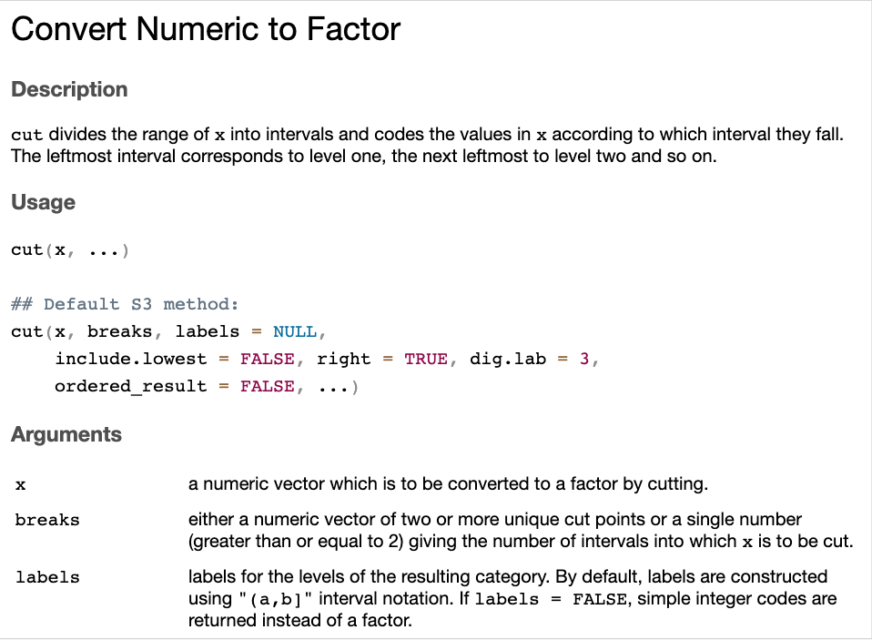
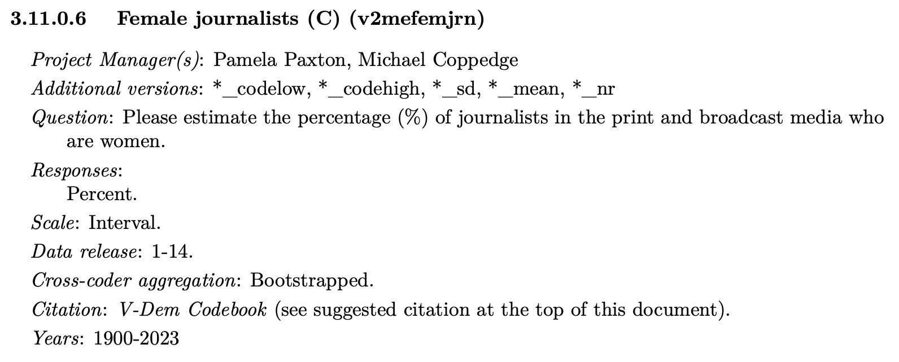

# Manipulating variables

Week 8 tutorial goals:

  + Reversing the scale of a variable
  + Changing categories
  + Turning continuous variables into categories with `cut()`
  + Creating and saving cross-tabs

## Set-up

### Make sure you have your project datasets and `W8.R` {-}
This week uses two files from your `Project` folder. They must be in these folders inside your R project folder:

+ CES 2025: `Project/CES2025/2025 Canadian Election Study v1.dta`
+ V-Dem: `Project/VDem/vdem2000_2023.csv`

### Load libraries {-}
```{r}
library(tidyverse)
library(haven)
library(sjPlot)
```

## Recode categories (CES 2025)

Sometimes we want to change the categories of a variable. We can reverse the order or combine categories. Use `mutate()` and `if_else()`, the same as in Week 5.

### Load data {-}
Only load the CES variables we need.
```{r}
my_vars <- c("cps25_tarrifs_3", "cps25_tarrifs_1", "cps25_province", "cps25_votechoice",
             "pes25_turnout2025", "cps25_age_in_years")

ces_selected <- read_dta("Project/CES2025/2025 Canadian Election Study v1.dta") |>
  select(all_of(my_vars))
```

+ Variables selected:
  + `cps25_tarrifs_3`: Do you support or oppose retaliatory tariffs against the US? (1 = Strongly support, 2 = Somewhat support, 3 = Somewhat oppose, 4 = Strongly oppose, 5 = Don't know)
  + `cps25_tarrifs_1`: Has the relationship between Canada and the US become better or worse after US President Trump's election? (1 = Better, 2 = Worse, 3 = Same as before, 4 = Don't know, 5 = Prefer not to answer)
  + `cps25_province`: Province or territory (1 to 13)
  + `cps25_votechoice`: Which party do you think you will vote for? (1 to 8, 7 = Don't know)
  + `pes25_turnout2025`: Did you vote in the 2025 federal election? (1 = Yes, 2 to 8 = various responses)
  + `cps25_age_in_years`: Age in years

### Reverse scale {-}

For `cps25_tarrifs_3`, a higher number means the person *opposes* tariffs more. If we want a "support for tariffs" variable, reverse the scale.

+ `cps25_tarrifs_3`: Do you support or oppose retaliatory tariffs against the US? (1 = Strongly support, 2 = Somewhat support, 3 = Somewhat oppose, 4 = Strongly oppose, 5 = Don't know)

#### Reverse the scale with `if_else()` {-}
We can change each category by hand: 1 becomes 4, 2 becomes 3, etc.

+ The first line creates `support_manual`. People who answered 1 get 4, and everyone else gets `NA` for now. 
+ Each line after that fills in one more category. If the test is `FALSE`, we keep what `support_manual` already was.
```{r}
ces_selected <- ces_selected |>
  mutate(support_manual = if_else(cps25_tarrifs_3 == 1, 4, NA),
         support_manual = if_else(cps25_tarrifs_3 == 2, 3, support_manual),
         support_manual = if_else(cps25_tarrifs_3 == 3, 2, support_manual),
         support_manual = if_else(cps25_tarrifs_3 == 4, 1, support_manual))
```

What about "don't know" (5)?

#### Shortcut to reverse {-}
Basic math: subtract the variable from 5 (highest value + 1). 

+ 1 becomes 5 - 1 = 4
+ 4 becomes 5 - 4 = 1

The math would turn "Don't know" (5) into 5 - 5 = 0, so first set 5 to `NA` in a new variable, the same as in Week 7.
```{r}
ces_selected <- ces_selected |>
  mutate(tariffs_oppose = if_else(cps25_tarrifs_3 == 5, NA, cps25_tarrifs_3),
         tariffs_support = 5 - tariffs_oppose)
```

What if you want to reverse but have the scale be 0-4?

#### Check the new variables {-}
Every 1 in the old variable is a 4 in the new variable, and so on.
```{r}
tab_xtab(var.row = ces_selected$cps25_tarrifs_3,
         var.col = ces_selected$tariffs_support)
```


#### It's important to look at categories {-}
Look at `cps25_tarrifs_1`


<!--  The categories are not in order: 3 ("Same as before") belongs between 1 ("Better") and 2 ("Worse"). So subtracting from a number would not put it in order.
```{r}
ces_selected |>
  group_by(cps25_tarrifs_1) |>
  reframe(n = n())
```


Union Yes/No example, commented out 2026-11-02 (Week 8 now uses the CES .dta, which has no `union`)

### Give categories clearer names {-}
In Week 6, we saw that `union` is coded 1 = yes and 0 = no. Sometimes values like "yes" and "no" are easier to work with.
```{r, eval=FALSE}
table(ces$union)
```

If `union` is 1, the new variable is "Yes". Otherwise it is "No".
```{r, eval=FALSE}
ces <- ces |>
  mutate(union_member = if_else(union == 1, "Yes", "No"))
```

#### Check the new variable {-}
Every 1 should be "Yes" and every 0 should be "No". People with `NA` for `union` still have `NA`.
```{r, eval=FALSE}
tab_xtab(var.row = ces$union,
         var.col = ces$union_member)
```
-->

### Combine categories: create a region variable {-}
`cps25_province` has 13 categories, and some have very few respondents. We can combine provinces into four regions: West, Ontario, Quebec and Atlantic.

  + `table(ces_selected$cps25_province)` works, but this is easier to read:

```{r}
ces_selected |>
  group_by(cps25_province) |>
  reframe(n = n())
```

#### Create the region variable with `if_else()` {-}
We build the new variable one region at a time, the same way we reversed the scale by hand.

+ The first line creates `region`. People from the West get "West", and everyone else gets `NA` for now.

+ `%in%` (from Week 4) checks whether a value is in a list: `cps25_province %in% c(1, 3)` is `TRUE` for anyone from Alberta (1) or Manitoba (3).

+ Each line after that fills in one more region. If the test is `FALSE`, keep what `region` already was.
```{r}
ces_selected <- ces_selected |>
  mutate(region = if_else(cps25_province %in% c(1, 2, 3, 12), "West", NA), # Alberta, BC, Manitoba, Saskatchewan
         region = if_else(cps25_province == 9, "Ontario", region),
         region = if_else(cps25_province == 11, "Quebec", region),
         region = if_else(cps25_province %in% c(4, 5, 7, 10), "Atlantic", region)) # NB, NL, NS, PEI
```


#### Check the new variable {-}
Every province should be in one region. The three territories (Yukon, Northwest Territories and Nunavut) are not in any region, so they are `NA`. Only 61 people live there.
```{r}
tab_xtab(var.row = ces_selected$cps25_province,
         var.col = ces_selected$region)
```


#### Crosstab of region and vote choice {-}

Let's do some bivariate analysis!

```{r}
tab_xtab(var.row = ces_selected$cps25_votechoice,
         var.col = ces_selected$region,
         show.col.prc = TRUE)
```

+ For your project, you might want to make a new vote choice variable, remove don't knows or other parties, etc.

## Age groups and turnout (CES 2025)

We keep using `ces_selected`.

### Create a turnout variable {-}
```{r}
ces_selected <- ces_selected |>
  mutate(turnout = if_else(pes25_turnout2025 == 1, "Voted", "Did not vote"))

table(ces_selected$turnout)
```

Wait! Is something wrong with this turnout variable? Possibly more than one thing!

### Age and turnout {-}

#### Crosstab using age as it is {-}
Age has almost 80 different values, so the crosstab has almost 80 columns. It is very hard to read.
```{r}
tab_xtab(var.row = ces_selected$turnout,
         var.col = ces_selected$cps25_age_in_years,
         show.col.prc = TRUE)
```

#### Create ordinal categories using function `cut()` {-}
`cut()` turns a numeric variable into categories.
```{r}
?cut # pull up the documentation for `cut()`
```

```{r echo=FALSE, out.width = "100%", fig.align = "center"}

```

#### Create age groups using `cut()` {-}
```{r}
ces_selected <- ces_selected |>
  mutate(age_groups = cut(cps25_age_in_years,
                          breaks = c(17, 29, 44, 64, 100)))

table(ces_selected$age_groups)
```

Note: cut includes to the right/higher, so `(17,29]` means 18 to 29.

#### Crosstab using age groups {-}
```{r}
tab_xtab(var.row = ces_selected$turnout,
         var.col = ces_selected$age_groups,
         show.col.prc = TRUE)
```

### Crosstab of tariff support and age groups {-}
```{r}
tab_xtab(var.row = ces_selected$tariffs_support,
         var.col = ces_selected$age_groups,
         show.col.prc = TRUE)
```

### Clear environment {-}
```{r}
rm(list=ls())
```

## Different ways of turning continuous variables into categories (V-Dem)

### Load data {-}
```{r}
my_vars <- c("country_name", "country_id", "year",
          "v2x_libdem","e_gdppc","v2mefemjrn", "v2pepwrgen")

vdem_selected <- read.csv("Project/VDem/vdem2000_2023.csv") |>
  select(all_of(my_vars)) |>
  filter(year==2010)
```

+ Variables selected:
  + `v2x_libdem`: Liberal democracy index
  + `e_gdppc`: GDP per capita
  + `v2mefemjrn`: % of female journalists
  + `v2pepwrgen`: Power distributed by gender

### Create ordinal categories using function `cut()` {-}

#### Consider this variable: v2mefemjrn (% of female journalists) {-}
```{r echo=FALSE, out.width = "100%", fig.align = "center"}

```

```{r}
summary(vdem_selected$v2mefemjrn)
```
The cut function has a "breaks" option which cuts the data range into equal sized parts.

  + splits the min-max range in four

```{r}
cut(vdem_selected$v2mefemjrn, # numeric variable
    breaks=4) |> # either number of intervals OR list of cut points
  head()

cut(vdem_selected$v2mefemjrn, # numeric variable
    breaks=c(10,30,50,70)) |> # either number of intervals OR list of cut points
  head()
```

#### Add the new ordinal variables to the data frame {-}
```{r}
vdem_selected <- vdem_selected |>
  mutate(female_journalists_groups = cut(v2mefemjrn,
                                         breaks = 4),
         gender_power_groups = cut(v2pepwrgen,
                                   breaks = 4))
```

#### Crosstab of female journalists and gender power {-}
```{r}
tab_xtab(var.row = vdem_selected$female_journalists_groups,
         var.col = vdem_selected$gender_power_groups,
         show.col.prc = TRUE)
```

#### Save a crosstab {-}

Add the option "file=" to save the crosstab to your computer in the working directory (your R project folder)

```{r}
tab_xtab(var.row = vdem_selected$female_journalists_groups,
         var.col = vdem_selected$gender_power_groups,
         show.col.prc = TRUE,
         file="crosstabs.html")
```


For your final project, open the html file on your laptop and copy the table into your Word document

### Skewed variables: GDP per capita {-}
```{r}
ggplot(vdem_selected,aes(x=e_gdppc)) +
  geom_histogram()
```

#### Crosstabs have lots of empty or small cells {-}
```{r}
vdem_selected <- vdem_selected |>
  mutate(gdp_groups = cut(e_gdppc,
                          breaks = 4),
         democracy_groups = cut(v2x_libdem,
                                breaks = 4))

tab_xtab(var.row = vdem_selected$gdp_groups,
         var.col = vdem_selected$democracy_groups,
         show.col.prc = TRUE)
```


#### Alternative using quantile cut points {-}

Use the "breaks = quantile" option to split into four categories with equal numbers of units

```{r}
quantile(vdem_selected$e_gdppc, probs = seq(0, 1, 0.25),na.rm=T)
```

The new variables end in `_quartiles`, so they don't replace the `_groups` variables we just made.
```{r}
vdem_selected <- vdem_selected |>
  mutate(gdp_quartiles = cut(e_gdppc,
                             breaks = quantile(e_gdppc, probs = seq(0, 1, 0.25),na.rm=T)),
         democracy_quartiles = cut(v2x_libdem,
                                   breaks = quantile(v2x_libdem, probs = seq(0, 1, 0.25),na.rm=T)))

tab_xtab(var.row = vdem_selected$democracy_quartiles,
         var.col = vdem_selected$gdp_quartiles,
         show.col.prc = TRUE)
```

### Clear environment {-}
```{r}
rm(list=ls())
```


## Credits
+ This lesson uses data from
  + Stephenson, Laura B., Allison Harell, and Daniel Rubenson. 2025 Canadian Election Study (CES). [dataset]
  + Varieties of Democracy (V-Dem) Project. [V-Dem Dataset](https://www.v-dem.net/data/the-v-dem-dataset/).

