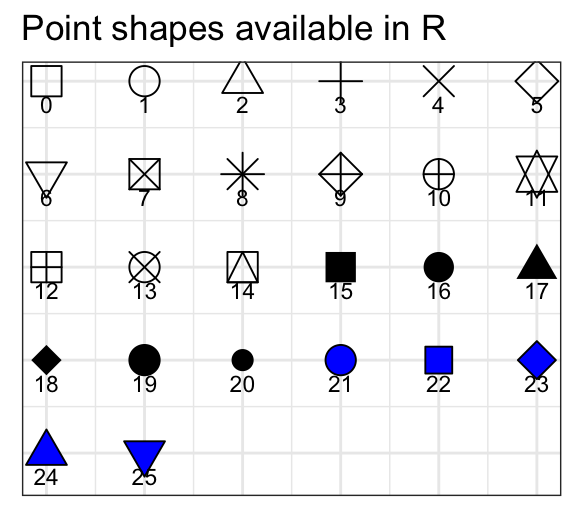

# Beautiful (and effective) Data Visualization

Week 10 tutorial goals:

  * Better ggplot presentation for key plot types (bar charts, box and whiskers, scatter plot)
  * Other graph specifications (themes, axes, font size, etc.)
    + themes, colours, legend and axis labels
    + text on bar charts
    + many points: jitter, transparency and hollow circles
    + saving plots -- `ggsave()`
  * Fancy graphs and options
    + reference lines
    + labelling some points
    + colour by a third variable
    + highlighting a group
    + dumbbell plot
    + just for fun: The Economist, Taylor Swift and cat themes
  * Optional: merging data from another dataset


## Set-up
```{r,include=FALSE}
library(tidyverse)
library(haven)
options(warn = -1) # suppress warning messages that do not disturb the program flow
```

### Make sure you have your project datasets and `W10.R` {-}
This week uses three files from your `Project` folder. They must be in these folders inside your R project folder:

+ Asian Barometer: `Project/asianbarometer_wave5/20230504_W5_merge_15.dta`
+ CES 2025: `Project/CES2025/2025 Canadian Election Study v1.dta`
+ V-Dem: `Project/VDem/vdem2000_2023.csv`

For the optional merging example, also put `statelist2024.csv` in your R project folder.

### Load libraries {-}
```{r,eval=F}
library(tidyverse)
library(haven)
```


## Bar charts

### Prepare variables (Asian Barometer) {-}

* Independent variable: Views toward the US
  * 175 Does the United States do more good or harm to Asia?

* Dependent variable: Views toward democracy (1 strongly agree - 4 strongly disagree)
  * 170 Democratic systems are not effective at maintaining order and stability

#### Load data and select variables {-}
```{r}
my_vars <- c("country","q170","q175")

ab_vietnam <- read_dta("Project/asianbarometer_wave5/20230504_W5_merge_15.dta") |>
  select(all_of(my_vars)) |>
  filter(country==11) # Vietnam
```

#### Recode variables {-}
Same as Week 7: make new variables with `if_else()`, and keep them in the same data frame. Codes below 1 or above 4 (missing, don't know) become `NA`.
```{r}
ab_vietnam <- ab_vietnam |> # save the new variables in the same data frame
  mutate(democracy_ineffective = if_else(q170 < 1 | q170 > 4, NA, q170),
         us_good_harm = if_else(q175 < 1 | q175 > 4, NA, q175))
```

#### Basic plot {-}
```{r}
ab_vietnam |>
  filter(is.na(democracy_ineffective) == FALSE, is.na(us_good_harm) == FALSE) |> # remove NAs right before the plot
  ggplot(aes(fill=factor(democracy_ineffective),x=factor(us_good_harm))) +
  geom_bar(position="fill")
```

* `theme_bw()` -- changes the background theme
* `scale_fill_manual` -- `name` to label legend title, `values` to change colors, `labels` to change name of levels
* `scale_x_discrete` -- adjusts x-axis; `labels` to change name of levels; `guide` to stagger labels to prevent overlapping
* `xlab` -- x-axis title
* `ylab` -- y-axis title
* `geom_text` -- adds text annotation


```{r}
ab_vietnam |>
  filter(is.na(democracy_ineffective) == FALSE, is.na(us_good_harm) == FALSE) |> # remove NAs right before the plot
  ggplot(aes(fill=factor(democracy_ineffective),x=factor(us_good_harm))) +
  geom_bar(position="fill") +
  theme_bw()
```

```{r}
ab_vietnam |>
  filter(is.na(democracy_ineffective) == FALSE, is.na(us_good_harm) == FALSE) |> # remove NAs right before the plot
  ggplot(aes(fill=factor(democracy_ineffective),x=factor(us_good_harm))) +
  geom_bar(position="fill") +
  theme_bw() +
  scale_fill_manual(name="Q170. Democratic\nsystems are not\neffective", #legend label; `\n` breaks line
                    values = c("navyblue","blue","skyblue","grey"), #color specification
                    labels = c("Strongly Agree","Somewhat Agree", "Somewhat Disagree", "Strongly Disagree")) #legend specification
```

```{r}
ab_vietnam |>
  filter(is.na(democracy_ineffective) == FALSE, is.na(us_good_harm) == FALSE) |> # remove NAs right before the plot
  ggplot(aes(fill=factor(democracy_ineffective),x=factor(us_good_harm))) +
  geom_bar(position="fill") +
  theme_bw() +
  scale_fill_manual(name="Q170. Democratic\nsystems are not\neffective", #legend label; `\n` breaks line
                    values = c("navyblue","blue","skyblue","grey"), #color specification
                    labels = c("Strongly Agree","Somewhat Agree", "Somewhat Disagree", "Strongly Disagree")) + #legend specification
  scale_x_discrete(labels=c("Much more good", "Somewhat more good", "Somewhat more harm", "Much more harm"),
                   guide = guide_axis(n.dodge=2)) +
  xlab("Q175. Does the United States do more good or harm to Asia?") +
  ylab("Proportion")
```


```{r}
ab_vietnam |>
  filter(is.na(democracy_ineffective) == FALSE, is.na(us_good_harm) == FALSE) |> # remove NAs right before the plot
  ggplot(aes(fill=factor(democracy_ineffective),x=factor(us_good_harm))) +
  geom_bar(position="fill") +
  theme_bw() +
  scale_fill_manual(name="Q170. Democratic\nsystems are not\neffective", #legend label; `\n` breaks line
                    values = c("navyblue","blue","skyblue","grey"), #color specification
                    labels = c("Strongly Agree","Somewhat Agree", "Somewhat Disagree", "Strongly Disagree")) + #legend specification
  scale_x_discrete(labels=c("Much more good", "Somewhat more good", "Somewhat more harm", "Much more harm"),
                   guide = guide_axis(n.dodge=2)) +
  xlab("Q175. Does the United States do more good or harm to Asia?") +
  ylab("Proportion") +
  geom_text(aes(x = factor(us_good_harm), # position along x axis follows us_good_harm
                label = round(after_stat(count / tapply(count, x, sum)[x]),3)), # text
            stat = "count",
            position = position_fill(vjust = .5), # position text at center of each fill block
            color="white")
```

### Clear environment {-}
```{r}
rm(list=ls())
```


## Box and whiskers plot

### Prepare variables (CES) {-}
```{r}
my_vars <- c("cps25_interest_gen_1","cps25_govt_confusing","cps25_age_in_years") # interest in politics, internal political efficacy and age

ces_selected <- read_dta("Project/CES2025/2025 Canadian Election Study v1.dta") |>
  select(all_of(my_vars))

ces_selected <- ces_selected |> # save the new variables in the same data frame
  mutate(govt_confusing = if_else(cps25_govt_confusing == 5, # don't know or refused
                                  NA, #if yes
                                  cps25_govt_confusing), #if no
         interest_gen = if_else(cps25_interest_gen_1 < 0, # -99 = don't know
                                NA, #if yes
                                cps25_interest_gen_1)) #if no
```


```{r}
ces_selected |>
  filter(is.na(govt_confusing) == FALSE, is.na(interest_gen) == FALSE) |> # remove NAs right before the plot
  ggplot(aes(x=factor(govt_confusing), y=interest_gen)) +
  geom_boxplot()
```

* `width` in `geom_boxplot` controls the width of the boxplot
* `geom_point(stat="summary", fun=mean)` adds a point plot of the conditional mean in addition to the quartiles noted in the box and whiskers
* ggplot shapes for point or scatter

```{r echo=FALSE, out.width = "60%", fig.align = "center"}

```

```{r}
ces_selected |>
  filter(is.na(govt_confusing) == FALSE, is.na(interest_gen) == FALSE) |>
  ggplot(aes(x=factor(govt_confusing), y=interest_gen)) +
  geom_boxplot(width=0.3, fill="darkseagreen") +
  geom_point(stat="summary", fun=mean, shape=23, fill="black",size=2.5) +
  scale_x_discrete(labels=c("1\nStrongly Disagree","Somewhat Disagree","Somewhat Agree","4\nStrongly Agree")) +
  theme_bw() +
  xlab("Sometimes, politics and government seem so complicated that a person\n like me can't really understand what's going on.") +
  ylab("How interested are you in politics generally?\n(0 = no interest, 10 = a great deal)")
```

## Scatter plot

### Many points: jitter, transparency and hollow circles (CES) {-}

With about 20,000 survey respondents, a plain scatter plot hides most of the data. Everyone with the same age and the same answer sits on the same dot.

```{r}
ces_selected |>
  filter(is.na(interest_gen) == FALSE) |>
  ggplot(aes(x=cps25_age_in_years, y=interest_gen)) +
  geom_point()
```

* `geom_jitter()` -- moves each point a little at random, so points don't sit on top of each other; `width` and `height` set how far
* `shape=1` -- hollow circles, so overlapping points stay visible
* `alpha` -- transparency (0 = invisible, 1 = solid); darker areas have more people

```{r}
ces_selected |>
  filter(is.na(interest_gen) == FALSE) |>
  ggplot(aes(x=cps25_age_in_years, y=interest_gen)) +
  geom_jitter(width=0.4, height=0.4, shape=1, alpha=0.1) +
  theme_classic() +
  xlab("Age") +
  ylab("How interested are you in politics generally?\n(0 = no interest, 10 = a great deal)")
```

### Clear environment {-}
```{r}
rm(list=ls())
```

### Prepare variables (VDem) {-}
```{r}
my_vars <- c("country_name", "country_id", "year", 
          "e_cow_exports","e_gdppc","e_gdp","e_cow_imports","v2x_pubcorr","v2x_regime","e_regionpol_6C")

vdem_selected <- read.csv("Project/VDem/vdem2000_2023.csv") |>
  select(all_of(my_vars)) |>
  filter(year==2014)

vdem_selected <- vdem_selected |> # save the new variable in the same data frame
  mutate(trade = (e_cow_exports+e_cow_imports)/(e_gdp)) # trade volume as proportion of gdp

ggplot(data=vdem_selected,aes(x=trade,y=v2x_pubcorr)) +
  geom_point()

ggplot(data=vdem_selected,aes(x=log(trade),y=v2x_pubcorr)) +
  geom_point()
```


### Saving plots using `ggsave()` {-}

```{r}
# save as object
trade_plot <- ggplot(data=vdem_selected,aes(x=log(trade),y=v2x_pubcorr)) +
  geom_point(alpha=0.8,size=2) +
  theme_classic() +
  xlab("Trade volume as proportion of GDP (logged)") +
  ylab("Public sector corruption")

# use ggsave(): specify `filename`, `plot`, `width` and `height` of image file
ggsave(filename = "trade_plot.png",
       plot = trade_plot,
       width=8, height=5)
```

## Fancy graphs and options

We keep using the V-Dem data from the scatter plot section.

### Reference lines {-}

* `geom_hline()` -- a horizontal line at `yintercept` (`geom_vline()` is vertical, at `xintercept`)
* `linetype` -- e.g. `"dashed"` or `"dotted"`
* `annotate()` -- adds a piece of text at the `x` and `y` you choose

```{r}
ggplot(data=vdem_selected,aes(x=log(trade),y=v2x_pubcorr)) +
  geom_point(alpha=0.8,size=2) +
  geom_hline(yintercept=mean(vdem_selected$v2x_pubcorr), # average corruption
             linetype="dashed", color="red") +
  annotate("text", x=3, y=0.53, label="Average corruption", color="red") +
  theme_classic() +
  xlab("Trade volume as proportion of GDP (logged)") +
  ylab("Public sector corruption")
```

### Label some points -- `geom_text()` {-}

Labelling every country would be unreadable, so we label only a few. First make a new variable with the country name for the countries we want, and `NA` for everyone else. `geom_text()` leaves out the `NA`s.

```{r}
vdem_selected <- vdem_selected |> # save the new variable in the same data frame
  mutate(country_label = if_else(country_name == "Canada" | country_name == "United States of America" |
                                   country_name == "China" | country_name == "Singapore" |
                                   country_name == "Russia" | country_name == "Venezuela",
                                 country_name, # if yes: use the country name
                                 NA)) # if no: no label
```

* `label` -- the variable that holds the text
* `vjust` -- moves the text up or down, so it doesn't sit on top of the point
* `size` -- text size

```{r}
ggplot(data=vdem_selected,aes(x=log(trade),y=v2x_pubcorr)) +
  geom_point(alpha=0.8,size=2) +
  geom_text(aes(label=country_label), vjust=-1, size=3) +
  theme_classic() +
  xlab("Trade volume as proportion of GDP (logged)") +
  ylab("Public sector corruption")
```

### Colour by a continuous variable {-}

Use `color` inside `aes()` to add a third variable, and `scale_color_gradient()` to pick the colours. Here, countries that trade more also tend to be richer.

```{r}
ggplot(data=vdem_selected,aes(x=log(trade),y=v2x_pubcorr)) +
  geom_point(aes(color=log(e_gdppc)),alpha=0.8,size=2) +
  theme_classic() +
  xlab("Trade volume as proportion of GDP (logged)") +
  ylab("Public sector corruption") +
  scale_color_gradient(name="GDP per capita (logged)",
                       low="black",high="red")
```

### Colour by a categorical variable {-}

GDP per capita is continuous, so we used `scale_color_gradient()`. For a categorical variable, use `factor()` and `scale_color_manual()`, just like `scale_fill_manual()` in the bar chart.

V-Dem's regime type (`v2x_regime`): 0 = closed autocracy, 1 = electoral autocracy, 2 = electoral democracy, 3 = liberal democracy.

```{r}
ggplot(data=vdem_selected,aes(x=log(trade),y=v2x_pubcorr)) +
  geom_point(aes(color=factor(v2x_regime)),alpha=0.8,size=2) +
  theme_classic() +
  xlab("Trade volume as proportion of GDP (logged)") +
  ylab("Public sector corruption") +
  scale_color_manual(name="Regime type",
                     values=c("darkred","orange","skyblue","navyblue"),
                     labels=c("Closed autocracy","Electoral autocracy","Electoral democracy","Liberal democracy"))
```

Liberal democracies cluster at the bottom right: high trade and low corruption. Regime type is another variable we would need to control for.

### Highlight a group {-}

Draw every country in grey, then draw the group you care about again on top in colour. The second `geom_point()` gets its own `data`: only the countries in the group.

V-Dem's region variable (`e_regionpol_6C`): 1 = Eastern Europe and Central Asia, 2 = Latin America and the Caribbean, 3 = Middle East and North Africa, 4 = Sub-Saharan Africa, 5 = Western Europe and North America, 6 = Asia and Pacific.

```{r}
ggplot(data=vdem_selected,aes(x=log(trade),y=v2x_pubcorr)) +
  geom_point(color="grey80",size=2) + # all countries
  geom_point(data=vdem_selected |> filter(e_regionpol_6C==5), # only Western Europe and North America
             color="navyblue",size=2) +
  theme_classic() +
  xlab("Trade volume as proportion of GDP (logged)") +
  ylab("Public sector corruption") +
  ggtitle("Western Europe and North America (blue) compared to the rest of the world")
```

### Dumbbell plot {-}

A dumbbell plot shows how something changed between two years: one dot for each year, joined by a line. Here: democracy in Latin America in 2000 and 2023.

```{r}
vdem_latin_america <- read.csv("Project/VDem/vdem2000_2023.csv") |>
  select(country_name, year, v2x_polyarchy, e_regionpol_6C) |>
  filter(year == 2000 | year == 2023, # two years
         e_regionpol_6C == 2) # Latin America and the Caribbean
```

* `geom_line(aes(group=country_name))` -- joins the two dots for each country
* `geom_point(aes(color=factor(year)))` -- one colour for each year

```{r, fig.height=6}
ggplot(data=vdem_latin_america, aes(x=v2x_polyarchy, y=country_name)) +
  geom_line(aes(group=country_name), color="grey60") +
  geom_point(aes(color=factor(year)), size=3) +
  theme_classic() +
  scale_color_manual(name="Year", values=c("grey60","darkred")) +
  xlab("Electoral democracy index (0 to 1)") +
  ylab("")
```

Now interpret: which countries became less democratic? Which became more democratic?

### Just for fun: themes and palettes {-}

Other people have made ready-to-use themes and colour palettes. Each one needs a new package. Themes like these are optional: they change how a plot looks, not what it shows.

#### The Economist -- `ggthemes` {-}
`ggthemes` copies the style of famous publications, e.g. `theme_economist()`, `theme_wsj()` (Wall Street Journal) and `theme_fivethirtyeight()`.
```{r,eval=F}
install.packages("ggthemes")
library(ggthemes)
```

```{r,include=F}
library(ggthemes)
```

```{r}
ggplot(data=vdem_selected,aes(x=log(trade),y=v2x_pubcorr)) +
  geom_point(aes(color=factor(v2x_regime)),size=2) +
  theme_economist() + # instead of theme_classic()
  scale_color_economist(name="Regime type",
                        labels=c("Closed autocracy","Electoral autocracy","Electoral democracy","Liberal democracy")) +
  xlab("Trade volume as proportion of GDP (logged)") +
  ylab("Public sector corruption")
```

#### Taylor Swift -- `taylor` {-}
`taylor` has a colour palette for each Taylor Swift album. Use `scale_color_taylor_d()` instead of `scale_color_manual()`, and pick an `album`.
```{r,eval=F}
install.packages("taylor")
library(taylor)
```

```{r,include=F}
library(taylor)
```

```{r}
ggplot(data=vdem_selected,aes(x=log(trade),y=v2x_pubcorr)) +
  geom_point(aes(color=factor(v2x_regime)),size=2) +
  theme_classic() +
  scale_color_taylor_d(album="Lover", # try "folklore", "Midnights", "1989"...
                       name="Regime type",
                       labels=c("Closed autocracy","Electoral autocracy","Electoral democracy","Liberal democracy")) +
  xlab("Trade volume as proportion of GDP (logged)") +
  ylab("Public sector corruption")
```

Notice the pale yellow points: they are hard to see on a white background. Fun palettes are not always easy to read.

#### Cats -- `ggcats` {-}
`ggcats` replaces the points with cats. It is not on CRAN, so you install it from GitHub with the `remotes` package.
```{r,eval=F}
install.packages("remotes")
remotes::install_github("R-CoderDotCom/ggcats@main")
library(ggcats)
```

```{r,include=F}
library(ggcats)
```

```{r}
ggplot(data=vdem_selected |> filter(e_regionpol_6C==5), # Western Europe and North America only
       aes(x=log(trade),y=v2x_pubcorr)) +
  geom_cat(cat="nyancat", size=3) + # other cats: "pusheen", "grumpy", "toast"...
  theme_classic() +
  xlab("Trade volume as proportion of GDP (logged)") +
  ylab("Public sector corruption")
```

### Clear environment {-}
```{r}
rm(list=ls())
```

## Optional: Merging data from another dataset

If you want to include data from other data sets, you must receive approval from the TAs or Prof. Besco prior to submission.

In this example, we add the year each country joined the international state system (from the Correlates of War state list) to V-Dem.

### Install the `countrycode` package {-}
```{r,eval=F}
install.packages("countrycode") # translates between country coding systems
library(countrycode)
```

```{r,include=F}
library(countrycode)
```

### Load both datasets {-}
```{r}
my_vars <- c("country_name", "country_id", "year",
          "e_cow_exports","e_gdp","e_cow_imports","v2x_pubcorr")

vdem_selected <- read.csv("Project/VDem/vdem2000_2023.csv") |>
  select(all_of(my_vars)) |>
  filter(year==2014) |>
  mutate(trade = (e_cow_exports+e_cow_imports)/(e_gdp)) # trade volume as proportion of gdp
```

```{r,eval=F}
cow_states <- read.csv("statelist2024.csv")
```

```{r,include=F}
cow_states <- read.csv("data/statelist2024.csv")
```

### Match the country codes -- `countrycode()` {-}

Each dataset numbers countries differently. In the Correlates of War (COW) list, Canada is `20`. V-Dem uses its own `country_id`. `countrycode()` translates COW codes (`"cown"`) into V-Dem codes (`"vdem"`).

```{r}
cow_states <- cow_states |>
  mutate(vdem_id = countrycode(ccode,
                               origin = "cown",
                               destination = "vdem"))
```

When you run this, R gives a warning: "Some values were not matched unambiguously: 31, 54, 55, ..."

  + These are COW codes that have no V-Dem code, for example small states (Bahamas, Monaco) and states that no longer exist (Austria-Hungary, Czechoslovakia).
  + Their `vdem_id` becomes `NA`. Nothing breaks: it is a warning, not an error.
  + It's a reminder to check which countries did not match, which we do after the merge.

### Keep one row per country {-}

Some countries left the state system and came back, so they have more than one row. We keep the earliest year for each country.

```{r}
cow_first <- cow_states |>
  group_by(ccode) |>
  slice_min(styear) |> # the row with the smallest (earliest) styear
  select(ccode, vdem_id, styear)
```

### Merge -- `left_join()` {-}

`left_join()` keeps every row of the first data frame (V-Dem) and adds the matching columns from the second (COW). `by` says which columns hold the same code.

```{r}
vdem_statehood <- left_join(vdem_selected, cow_first,
                            by = c("country_id" = "vdem_id"))
```

### Check the merge {-}

Always check which rows did not match. Here 5 of 179 countries have no start year: places that are not states in the COW list (Palestine, Somaliland, Hong Kong), and Serbia, whose COW code `countrycode()` cannot match.

```{r}
vdem_statehood |>
  filter(is.na(styear)) |>
  select(country_name)
```

### Plot {-}
```{r}
ggplot(data=vdem_statehood,aes(x=log(trade),y=v2x_pubcorr)) +
  geom_point(aes(color=styear),alpha=0.8,size=2) +
  theme_classic() +
  xlab("Trade volume as proportion of GDP (logged)") +
  ylab("Public sector corruption") +
  scale_color_gradient(name="First year in state system",
                       low="black",high="red")
```

### Clear environment {-}
```{r}
rm(list=ls())
```

## Credits
* This lesson uses data from
  * Asian Barometer Survey, Wave 5. [Asian Barometer](https://www.asianbarometer.org/).
  * Stephenson, Laura B., Allison Harell, and Daniel Rubenson. 2025 Canadian Election Study (CES). [dataset]
  * Varieties of Democracy (V-Dem) Project. [V-Dem Dataset](https://www.v-dem.net/data/the-v-dem-dataset/).
  * Correlates of War Project. 2024. State System Membership (v2024). [COW State System](https://correlatesofwar.org/data-sets/state-system-membership/).
